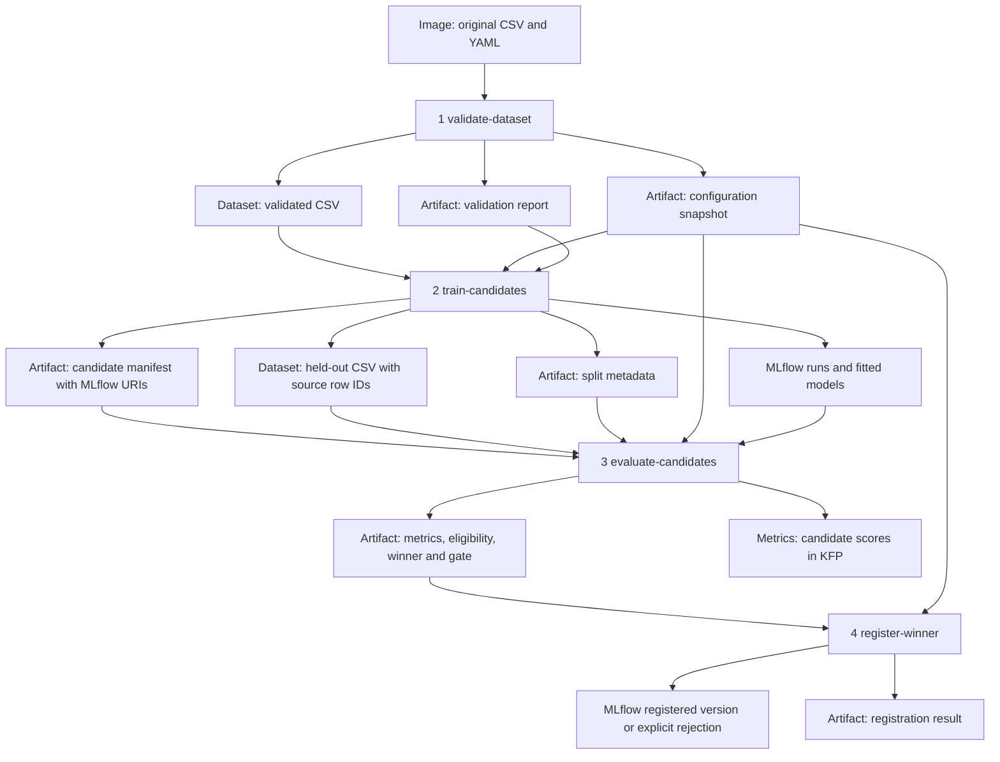

# Architecture and data flow

## Four real stages



KFP's launcher materializes input artifacts before invoking the process and uploads
output files after success. The backend's configured pipeline root determines their
object-store URIs; MinIO is the intended KFP store here. Application code receives local
artifact paths, not MinIO credentials. The image contains source data only for stage 1.
Training and evaluation do not independently reopen that original CSV.

## Contracts

| Stage | Inputs | Outputs | Functions |
|---|---|---|---|
| Validate | Source CSV path and YAML path in image | `Output[Dataset]` validated dataset; `Output[Artifact]` configuration and validation report | `validate_stage`, `load_config`, `check_config`, `validate_dataset`, splitter preflight |
| Train | `Input[Dataset]`; configuration/report artifacts; tracking URI; KFP execution ID | Candidate-manifest artifact; held-out Dataset; split-metadata artifact | `train_stage`, `split_dataset`, `train_model` |
| Evaluate | Manifest, held-out Dataset, split and configuration artifacts; tracking URI | Evaluation Artifact; `Output[Metrics]` | `evaluate_stage`, `load_model`, `evaluate_model`, `passes_quality_gate`, `select_best_model` |
| Register | Evaluation and configuration artifacts; tracking URI | Registration-result Artifact | `register_stage`, version search, `register_model`, registry retrieval |

The evaluation report contains candidate metrics/eligibility, selected candidate or
null, and an explicit gate object. These are kept together in one typed Artifact to
avoid independently inconsistent winner/gate parameters. Registration recomputes the
selection from that report and rejects contradictions before any registry creation.
The candidate manifest references models in MLflow; it is not itself a fitted model.

### File content schemas

- Validated CSV: all original columns with validated numeric values, original row order,
  no injected label encoding. Validation report records original and normalized CSV hashes,
  counts, feature order, label and class counts.
- Configuration: JSON snapshot of loaded YAML, hashed before downstream use. JSON preserves
  the model mapping's order and avoids a task independently reading a changed YAML file.
- Held-out CSV: ordered feature columns, target and `__source_row_id`. That reserved ID is
  excluded from model inputs; evaluation checks its order against recorded test row IDs.
- Split metadata: train/test IDs, sizes, seed, ratio, stratification, hash of each ordered
  ID list, held-out file hash and validation lineage. DataFrame index IDs are provenance,
  not customer identifiers and not predictors.
- Manifest: execution/experiment/parent IDs, four ordered model names, actual MLflow model
  URIs, child run IDs and shared held-out/config/split hashes.
- Evaluation: four metric dictionaries, confusion matrices, eligibility, winner, quality
  policy and lineage.
- Registration: explicit registered/not_registered status, version or null, actual source
  run/URI, metrics and retry key/reuse flag.

These hashes detect accidental content changes; they are not signed authenticity proofs.
CSV is simple and inspectable for this dataset. Parquet is an alternative for larger or
more complex typed data. No DataFrame or fitted Python object is passed between pods.

## Tracking and model lineage across processes

```mermaid
sequenceDiagram
    participant T as Train process
    participant E as Evaluate process
    participant R as Register process
    participant M as MLflow
    T->>M: Create parent execution run
    T->>M: Create four nested child runs and log models
    T->>M: End contexts; tag awaiting_evaluation
    T-->>E: Manifest with explicit run IDs and URIs
    E->>M: Resume parent and each child by run_id
    E->>M: Load actual model URI, log metrics to that child
    E->>M: Log comparison to parent; tag awaiting_registration
    E-->>R: Evaluation artifact
    R->>M: Resume parent; check retry key / register winner
    R->>M: Query version, load registered model, log result
    R->>M: End context; tag workflow_state=completed
```

An active MLflow context is process-local. The application never assumes that stage 2's
context remains active in stage 3. Context managers explicitly end each resumed run;
exceptions set the active run to FAILED. Between stages, MLflow may show FINISHED because
a context has ended, while `workflow_state` still says awaiting evaluation/registration.
The KFP run status is the orchestration authority. A failure before a resumed context
(for example an input hash mismatch) fails the KFP task but cannot automatically mark all
previous MLflow runs failed. No failure-handler infrastructure was introduced.

## Responsibilities

Kubernetes schedules task pods. KFP decides task readiness from artifact dependencies,
manages launcher execution, stores task state and publishes KFP/MLMD artifact lineage.
MinIO holds KFP artifact bytes through the launcher. MLflow owns experiment parameters,
candidate models, metric artifacts and registered versions. The existing MLflow server
uses its own configured artifact persistence; this implementation does not reconfigure
it or assume that its artifacts are in the KFP bucket.

A Python function call returns an in-memory object in one interpreter. A KFP component
specifies a container execution whose output must survive process and pod termination.
A control-only `.after()` creates an ordering constraint. Here artifact arguments create
both ordering and concrete producer/consumer data relationships. No `.after()` is needed.

Dataset artifacts describe examples and labels. Model artifacts contain fitted encoder,
scaler and classifier state. Training fits that state using only training rows; evaluation
uses it without refitting on held-out rows. Tracking records what happened; registry
creation gives an approved candidate a named version. Pipeline success means software
steps finished, whereas model quality is the gate decision. All-rejected runs complete
successfully with a clear non-registration result.

## Failure, retry, caching and resource decisions

All caching is disabled. Training, evaluation and registration write externally to MLflow;
replaying a cached output could hide those side effects. Validation is deterministic for
fixed image/data/config but is also uncached to ensure visible fresh checks and provenance.
Immutable external data references would be needed before safely enabling validation caching.

No automatic task retries are configured. Training retries could create new parent/candidate
runs. Evaluation retries resume the same IDs and overwrite named artifacts/log new metric
history; they do not create new candidates. Registration first searches every version page
for a matching SHA-256 key, winner URI and source run. The key includes registry name,
parent run and model URI. Tags are supplied at version creation, avoiding a separate
post-create tagging gap. Sequential retries are tested to reuse the version. Simultaneous
registrations can race between lookup and creation: this is best-effort idempotency,
not a distributed exactly-once guarantee. No existing version is deleted or mutated.

| Stage | CPU request / limit | Memory request / limit |
|---|---|---|
| Validate | 100m / 1 | 256Mi / 1Gi |
| Train | 500m / 2 | 1Gi / 3Gi |
| Evaluate | 250m / 1 | 512Mi / 2Gi |
| Register | 100m / 1 | 256Mi / 1Gi |

KFP launcher overhead and profile quota must also fit the workstation. The versioned
local image uses explicit IfNotPresent, but import must cover every schedulable node.
A private registry is an alternative for multiple nodes; public publishing is not authorized.

## Alternatives intentionally deferred

One task per candidate could parallelize training but adds split distribution, fan-in and
lineage complexity. Four stages preserve a single shared split with the requested four
visible boundaries. Models could be stored as KFP Model artifacts, but keeping actual
models in MLflow preserves the existing model logging/registry contract. Authentication,
production serving, monitoring, CV, a final untouched test set, distributed locking and
large-scale data storage are outside this implementation.

Primary references: [KFP typed artifacts](https://www.kubeflow.org/docs/components/pipelines/user-guides/data-handling/artifacts/),
[KFP container components](https://www.kubeflow.org/docs/components/pipelines/user-guides/components/container-components/),
[MLflow model logging](https://www.mlflow.org/docs/latest/api_reference/python_api/mlflow.sklearn.html).
